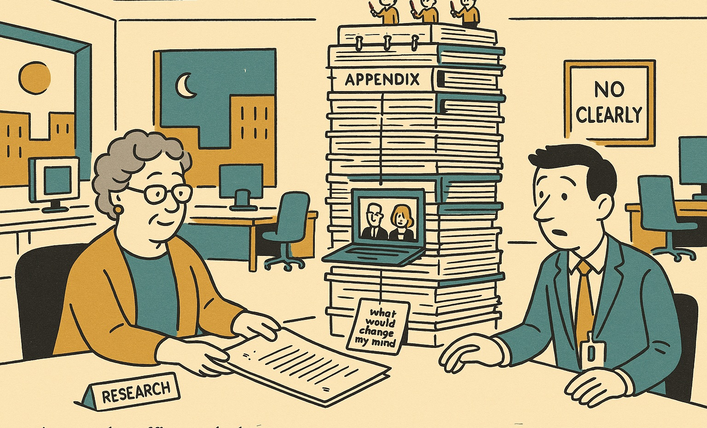

# Brenda from Research



Brenda from Research has already read the earnings call, the regulator's filing and the two sceptics on LinkedIn. Ask her a question on Monday morning. On Monday afternoon you get seven pages, numbered footnotes, a short list of things that would change her mind, and the archive one click away. Before she sends you anything, four other Brendas read it and tell her what she missed, what she overstated and what she buried. You get the version that survived.

Brenda does not have opinions. Brenda has sources. She lays out where they disagree, says which side has the better evidence, and lets you make the call. She has never once written "clearly".

In plainer terms: this is a Claude Code deep-research engine. It runs a sixteen-step pipeline on top of the `hyperresearch` CLI and vault, and it ends in a decision brief written the way a human expert would write it, not in a twenty-page document dump.

## What she does

1. **Reads widely.** Academic APIs first, then the web, then the sceptics. Every source lands in a local vault as a note with a summary, tags and the raw file.
2. **Finds the questions that matter.** Two analysts read the corpus and name the handful of places where going deeper would change the answer. Each gets its own investigation.
3. **Drafts three ways.** Three sub-orchestrators write the whole report from different angles (breadth, depth, practitioner). A synthesizer writes a fresh report from all three in one voice.
4. **Lets four critics at it.** One checks every claim against the evidence. One checks for technical depth left on the table. One checks for topics the corpus covers that the draft skipped. One checks the draft against the brief, item by item. A patcher applies what survives, with surgical edits only.
5. **Writes it for a human.** The final brief is six to seven pages: the controlling finding in the first sentence, a key-numbers strip, at most six numbered sections, one "what would change this reading" callout, options described and never ranked, then footnotes, further reading and a linked appendix for the long tables.

## How to ask her

```
/brenda <your question>
```

`/brenda` is an alias for the `/hyperresearch` entry skill. Step 1 sorts the question into a light run (bounded question, 30 to 40 minutes) or a full run (open question, all sixteen steps with adversarial review, 1.5 to 2.5 hours). The brief lands at `research/notes/final_report_<tag>.md`, the appendix next to it, and every source stays in the vault for follow-up questions.

## House style

`STYLE-GUIDE.md` is the source of truth for how the brief reads. The short version:

- Open on a thought. The first sentence is the finding, not the scope.
- Each paragraph is an assertion, two or three named instances, and a closing sentence with the strongest word last.
- One footnote per claim, on the verb or the noun. Never a chain of brackets.
- Calibration in words ("rests on a single job advertisement"), never as a label.
- Observations, not verdicts. The reader is the expert; the brief makes the call easier.
- Body of 2,500 to 3,500 words unless the brief asks for more. Everything else goes to the appendix, not the bin.
- No em-dashes.

The craft references are two Eric Schmidt essays (Foreign Affairs, October 2026; MIT Technology Review, August 2026) for the sentences, and Zinsser, Clark and Strunk for the reasons behind them. The brief borrows their sentences, not their stance.

## Layout

- `.claude/skills/brenda/` is the alias entry point; `.claude/skills/hyperresearch/` is the router over the sixteen steps.
- `.claude/skills/hyperresearch-1-decompose/` through `hyperresearch-16-readability-audit/` hold one step each.
- `.claude/agents/hyperresearch-*.md` are the subagent prompts: fetcher, loci analyst, depth investigator, draft orchestrator, synthesizer, four critics, patcher, polish auditor, readability recommender, corpus critic, source analyst.
- `.claude/settings.json` registers the pre-tool hook the CLI uses.
- `CLAUDE.md` is the project instruction file for a vault that uses this engine.
- `STYLE-GUIDE.md` is the report style, with each rule traced to where it came from.
- `assets/` holds Brenda.

The internal step and agent names keep the `hyperresearch` prefix because the CLI package and the vault format are still upstream `hyperresearch`. Brenda is the engine that runs on top of them.

## Requirements

- Claude Code with the `hyperresearch` CLI installed (`pipx install hyperresearch`), and the CLI path in `CLAUDE.md` adjusted to the local machine.
- A vault directory containing `research/` and `.hyperresearch/`, created with `hyperresearch init`.
- An OpenAI or Perplexity key only if you use the optional web-search agent; the pipeline itself needs neither.

## Syncing

The vault directory is the git working tree. Only the engine files are tracked; notes, raw sources and the SQLite index stay local. After editing anything under `.claude/`, `CLAUDE.md`, `STYLE-GUIDE.md` or `assets/`:

```
git add -A && git commit -m "describe the change" && git push
```

## Lineage

Brenda grew out of the hyperresearch V8 pipeline. October 2026 changes, in order: the argumentative voice was replaced with a calibrated one (Oct 16); sentence-style headings became numbered noun-phrase sections, and options stopped being ranked (Oct 19); the report became a six-to-seven-page decision brief with footnotes, further reading and a linked appendix, written to read as a human expert would write it (Oct 23). At that point it stopped being a tuning of hyperresearch and became Brenda.
